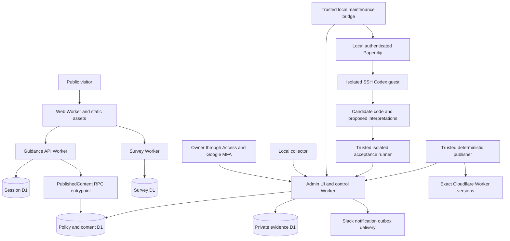

# SourceWayfinder implementation status and technical record

**Current update: November 26, 2026 — America/Los_Angeles.**

The current development candidate adds two account-recovery research drafts and website discovery improvements. See [the dated product handoff](PRODUCT_ENHANCEMENTS_2026-11-26.md). Type checking and builds pass; the source-independent suite passed 150 unit/integration tests and 34 browser checks, followed by targeted layout/fallback and search checks. The new 23 proposed recovery cases have **not** been semantically accepted or approved.

The later retained November 23 policy evidence records interpretation approval, expected-answer approval, an authorized isolated run passing all 18 Verizon cases plus branch coverage, merge-candidate authorization and a prepared staging receipt. Those milestones supersede the earlier pending/empty-dashboard checkpoints preserved below. They do not establish a Git merge, deployment approval, traffic promotion, activation or complete hosted source-change qualification. Today's changed web artifacts are a new candidate and cannot inherit that older run's authorization.

No production deployment or credential use occurred in this update. New Google scenarios remain under review and offer official-source handoffs only. Their approximately 1.6 MiB raw research pages also exceed the current production collector's 1 MiB limit; a reviewed bounded ingestion approach is needed before hosted content review.

## Historical November 23 implementation record

The following sections preserve their original checkpoints; use the current update above for the later milestone and today's work.

SourceWayfinder has an implemented platform candidate, an operational local Paperclip/Codex environment, and passing local and hosted engineering checks. The production platform has not been released. The Verizon and SSA bundles remain unpublished drafts. The owner has reviewed all 18 Verizon cases, and 36 local UI/API/session-D1 journeys passed. Authenticated policy decisions and protected acceptance remain pending; SSA content review has not been completed.

This document records what was built, how it works, the evidence observed during implementation, and the remaining delivery gates. “Implemented” means code exists. “Verified locally” means the stated behavior was observed in the local test environment. Neither term means that protected staging, production operations, or the real guidance have passed their outstanding acceptance gates.

## Current hosted milestone — November 23, 2026

The owner-run bootstrap is now observed working: the protected admin dashboard and public staging homepage load after owner authentication, the domain API returns an empty registry, and the isolated survey service reports Cloudflare storage. The admin has zero source, flow, proposal, release and audit records. No hosted guidance journey or content approval is implied. Screenshots and exact observations are recorded in [the staging plan](validation/verizon-sim-protection/HOSTED_STAGING_PLAN.md).

A missing admin source-registration form has been implemented locally. It shows the proposed Verizon scope and source boundaries, requires an explicit owner decision, and safely resumes partial registration by comparing exact server records. The owner ran the constrained staging admin update, and the hosted registration form is now independently verified. The owner then registered the flow and all three official source boundaries. The hosted audit trail confirms four events; the flow remains under review with no source evidence uploaded. The historical setup entries below describe their original checkpoints; actual sign-in is now verified.

## Local reliability follow-up — November 22, 2026

The working tree now fixes source normalization that missed destinations/form instructions and status polling that could block session expiry. The modified checkout passes 104 unit/integration tests, 25 browser checks, type checking and the artifact build. New tests include a fictional link-only source change propagated through the policy service, local D1, actual Worker API and browser, with guidance suspension and refusal of new sessions. See [the reliability report](validation/RELIABILITY_FIXES_2026-11-22.md).

These changes are local and uncommitted; the runtime snapshots and hosted results recorded below remain historical. No runtime synchronization, merge or deployment occurred. The [Verizon review packet](validation/verizon-sim-protection/REVIEW.md) now records the owner’s **Keep as written** decisions for all eighteen cases. The matching draft and expectations passed 36 local browser journeys at 320px and 1440px, covering all 27 transitions at each width. Full API outcomes, visible guidance, source links and session deletion matched expectations; 104 unit/integration tests also passed again.

See [the local validation report](validation/verizon-sim-protection/LOCAL_VALIDATION_RESULTS.md). This run used the actual built UI/API and ephemeral session D1 with a read-only content test provider. It did not validate policy authorization, the deployed control service, hosted access, or any Verizon account transaction. Those gates remain open. Your exact marked review was preserved byte-for-byte.

## Protected staging setup follow-up — November 22, 2026

The owner activated Cloudflare Zero Trust Free and connected Google. The Google provider test succeeded with the confirmed owner email. Both full-host Access applications are now saved for staging and its approval dashboard, restricted to that Google identity with independent Cloudflare authenticator MFA and six-hour sessions. Actual MFA enrollment and application sign-in remain untested.

The four staging deployment configurations now include verified account/database identities, Access audiences, custom hostnames and service bindings. A credential-free bootstrap package is prepared for the owner's separate operator directory. Its seven boundary tests and the full 111-test unit/integration suite passed, along with type checking and the artifact build. The platform has not been deployed by this follow-up. No authenticated content decision, protected acceptance receipt or hosted guidance result exists yet. See [the current staging plan](validation/verizon-sim-protection/HOSTED_STAGING_PLAN.md) and [operator instructions](STAGING_BOOTSTRAP.md).

## 1. Historical implementation delivery snapshot

| Area                     | Implemented and observed                                                                                                                                                   | Still pending                                                                                    |
| ------------------------ | -------------------------------------------------------------------------------------------------------------------------------------------------------------------------- | ------------------------------------------------------------------------------------------------ |
| Repository               | Private `abhs007/sourcewayfinder-platform`; [draft PR #1](https://github.com/abhs007/sourcewayfinder-platform/pull/1); implementation branch and clean committed candidate | Owner review and merge                                                                           |
| Existing prototype       | All 37 original files and preserved copies checked against a SHA-256 inventory                                                                                             | Keep the production survey intact during eventual migration                                      |
| Local orchestration      | Authenticated Paperclip, PostgreSQL, isolated SSH executor, restricted gateway, seven agents and two projects                                                              | Real provider quota/expired-login recovery qualification; operational maintenance admission      |
| Application              | Public and admin React applications; four Worker builds; deterministic evaluator and D1 repositories                                                                       | Protected hosted staging and production deployment                                               |
| Policy                   | Source/evidence records, approval chains, exact CI-result binding, shared-runtime protection and publication guards                                                        | Hosted Access/Google MFA and hosted concurrency/release drills                                   |
| Guidance content         | Five retained official pages; two draft bundles; 31 proposed semantic cases                                                                                                | Human interpretation/expectation approvals and authorized tests                                  |
| Cloudflare               | Workers Free verified; four staging D1 databases provisioned and migrated; existing survey database preserved                                                              | Access enrollment, restricted credentials, full deployment configuration and hosted verification |
| CI and testing           | 93 unit/integration tests, 18 browser checks, two backup tests, isolated fictional acceptance and hosted CI passed                                                         | Real-flow semantics, hosted capacity, full source-change and failure/recovery cycles             |
| Backups                  | Encrypted Drive upload/download verification; actual archive restored into disposable PostgreSQL and five local SQLite databases                                           | Durable owner-owned OAuth client, offline key custody, hosted D1 and full lost-runtime recovery  |
| Notifications/monitoring | Slack setup/sender code, quota monitor, scheduling code and external-monitor contract                                                                                      | Slack installation, alert delivery, external uptime and supplemental telemetry                   |

The validated implementation snapshot is `2b9fbf541f291e24a50fcb9779ffaec8d39a7497`, following implementation commit `c381ec088151f6439a65576c2aab943d062e7eb1`. Both Paperclip projects were synchronized to that snapshot. Later documentation commits should not be mistaken for a new runtime synchronization or a newly tested application release.

Hosted validation passed for both snapshots: [first run](https://github.com/abhs007/sourcewayfinder-platform/actions/runs/45020367106), [follow-up run](https://github.com/abhs007/sourcewayfinder-platform/actions/runs/45020810154). These workflows validate engineering behavior; they do not approve real guidance or production.

## 2. Architecture and trust boundaries

The public request path consists of Cloudflare Workers, static assets and D1. Paperclip and Codex operate locally as development and maintenance tools. Public visitors never wait for an agent or a model response.



The diagram shows the implemented target topology. The hosted Access, notification and release connections are not yet qualified live.

### Independently deployable services

| Component     | Owning code                                                                  | Data and bindings                                       | Responsibility                                                                                              |
| ------------- | ---------------------------------------------------------------------------- | ------------------------------------------------------- | ----------------------------------------------------------------------------------------------------------- |
| Public web    | [`workers/web/index.ts`](../workers/web/index.ts), [`apps/web`](../apps/web) | `ASSETS`, `GUIDANCE`, `SURVEY`                          | Serve the public experience, forward dynamic routes, apply security headers, enforce staging authentication |
| Guidance API  | [`workers/api/index.ts`](../workers/api/index.ts)                            | `SESSIONS_DB`, restricted `CONTENT`, `GUIDANCE_LIMITER` | Validate bundles, manage capability sessions and evaluate reviewed rules                                    |
| Control/admin | [`workers/control`](../workers/control), [`apps/admin`](../apps/admin)       | `CONTROL_DB`, `EVIDENCE_DB`, `ASSETS`, identity/secrets | Hold policy authority, human reviews, evidence, jobs, release eligibility and admin UI                      |
| Survey        | [`workers/survey/index.js`](../workers/survey/index.js)                      | Existing-compatible `DB`, `SURVEY_LIMITER`              | Preserve survey validation, consent, persistence, status and retention                                      |

The guidance API receives the named `PublishedContent` entrypoint. Its methods are `listFlows`, `getFlow`, `getBundle` and `getSources`. It has no approval mutation interface and no policy database binding. The default control-service HTTP interface separately authenticates human and automation requests.

This implementation replaces the original rented-server/public Fastify/hosted PostgreSQL/R2 proposal with Cloudflare Workers, D1 and bounded private/local evidence storage. PostgreSQL is retained only for Paperclip.

All application services are stateless outside D1. Process memory is not authoritative for sessions, approval decisions, release pointers or maintenance leases. Paperclip's PostgreSQL stores local orchestration state only; it is not the public platform's application database.

## 3. Repository structure and pinned tools

| Path                | Contents                                                                                                       |
| ------------------- | -------------------------------------------------------------------------------------------------------------- |
| `apps/web/`         | Public React application, generic guidance renderer, static fallback and preserved survey assets               |
| `apps/admin/`       | Review dashboard and exact-artifact approval/activation interactions                                           |
| `packages/core/`    | Framework-independent evaluator, bundle schema, generated validator, canonical hashing and strict JSON parsing |
| `workers/api/`      | Public protocol and session migration                                                                          |
| `workers/control/`  | Authentication, policy transitions, private published-content reader, control/evidence migrations              |
| `workers/survey/`   | Preserved survey service/schema and compatible migration                                                       |
| `workers/web/`      | Edge routing, response protections and staging identity checks                                                 |
| `domains/`          | Official source configuration, draft Verizon/SSA bundles, review packets and proposed cases                    |
| `infra/cloudflare/` | Current staging database configuration; generated full deployment configurations after identity setup          |
| `infra/paperclip/`  | Containers, networking, SSH, approved sandbox profiles, role instructions and runtime pins                     |
| `ops/`              | Collector, bridge, monitor, builds, migrations, runtime setup, backups, trusted tests and publisher            |
| `tests/`            | Fictional unit, local-D1, authentication, operator-boundary and browser checks                                 |
| `docs/`             | Operating procedures and detailed delivery evidence                                                            |

`private/`, `.env*`, `.dev.vars*`, dependency directories, build output and test artifacts are excluded from Git as appropriate. Docker's root build context uses an allowlist for the test-runner Dockerfile and package manifests. Local source snapshots and credentials are not included in the agent source replica.

The observed build runtime was Node **26.13.1**. `package.json` accepts Node `>=24.11`; CI explicitly selects 26.13.1. The dependency versions and transitive resolution are committed in `package.json` and `package-lock.json`.

| Tool/library      | Pin                                                                  |
| ----------------- | -------------------------------------------------------------------- |
| React / React DOM | 19.3.1                                                               |
| TypeScript        | 7.0.2                                                                |
| Vite              | 8.3.8                                                                |
| esbuild           | 0.28.2                                                               |
| Vitest            | 5.1.1                                                                |
| Playwright        | 1.65.1                                                               |
| Wrangler          | 4.166.0                                                              |
| Miniflare         | 5.20261119.0-beta                                                    |
| AJV / ajv-formats | 8.20.0 / 3.0.1                                                       |
| jose              | 6.2.18                                                               |
| parse5            | 8.0.0                                                                |
| tsx / Prettier    | 4.23.15 / 3.10.1                                                     |
| Codex CLI         | 0.169.1                                                              |
| Paperclip source  | `7671e0cf0d718351f3b0c4d6a7d33df9867ffb8a`, with documented overlays |
| Local PostgreSQL  | 17.9-alpine, pinned image digest                                     |

The handlers use Worker `fetch`/RPC interfaces directly. A package appearing in the lockfile is not evidence that every service uses it as its router. Local Miniflare configuration is adapted with `convertV4MiniflareOptions` to match the installed runtime generation.

## 4. Public website and reusable guidance UI

The redesigned public site uses warm neutral backgrounds, dark teal text, readable serif/sans typography, task choices, visible scope and restrained motion. The home page provides direct official links even when guided answers are unavailable. The static shell and fallback stylesheet do not depend on successful guidance API calls.

The shared renderer displays single-choice questions, explicit unknown choices, help, prerequisites, outcomes, unresolved conditions and source references. Domain branching is contained in bundles; Verizon and SSA do not have separate procedural logic embedded in the renderer.

Sessions are held in browser memory. There is no successful-guidance service-worker replay, browser-persistent session capability or offline decision cache. A new status epoch, stale source or unavailable authority causes a visible stop/fallback rather than continued use of an old decision.

Browser checks cover keyboard-only completion, focus/labels, reduced motion, 320px layouts, visible sources, unavailable API behavior and administrative denial/review interactions. Desktop and mobile screenshots were retained and inspected. This is not a completed WCAG 2.2 AA audit or a real assistive-technology certification; those remain separate checks.

The admin application provides source/proposal/release review, exact gate/digest submission with a reason, recovered-source revalidation, audit/status visibility, suspension and explicit activation. Activation sends the displayed release ID, bundle hash and status epoch. It is not an unrestricted “make active” toggle.

## 5. Guidance evaluator, validation and public API

[`packages/core/index.ts`](../packages/core/index.ts) contains the evaluator and validation helpers. [`ops/build-schema.mjs`](../ops/build-schema.mjs) generates the standalone AJV validator before builds/tests. Generating validation code at build time avoids runtime dynamic-code generation in Workers.

Validation checks schema shape, identifiers and references, the entry question, allowed choices, transition completeness, unknown-choice handling, reachability, cycles and outcome/source links. JSON parsing rejects duplicate keys. Canonical serialization and SHA-256 bind artifacts independently of JSON property order.

### HTTP interface

| Method and route                    | Behavior                                                                                     |
| ----------------------------------- | -------------------------------------------------------------------------------------------- |
| `GET /api/v1/domains`               | Discover available domains/flows and their status                                            |
| `GET /api/v1/flows/:id`             | Retrieve authoritative flow metadata/status                                                  |
| `GET /api/v1/sources/:id`           | Retrieve published source references                                                         |
| `POST /api/v1/sessions`             | Create a session using exact `{flowId, locale}` with English locale                          |
| `POST /api/v1/sessions/:id/answers` | Submit exact `{questionId, choiceId, sequence}` with bearer capability and `Idempotency-Key` |
| `DELETE /api/v1/sessions/:id`       | Delete the matching capability-authorized session                                            |
| `GET /healthz`                      | API-component health endpoint; not an additional public routing commitment                   |

Public JSON bodies are capped at **8 KiB**, including streamed-body enforcement. Unexpected fields, unsupported choices, invalid methods and cross-site/wrong-origin requests are rejected. Responses include request identifiers and safe typed errors such as `SESSION_UNAUTHORIZED`, `SESSION_EXPIRED`, `STALE_SEQUENCE`, `FLOW_CHANGED`, `FLOW_UNDER_REVIEW` and `CONTENT_UNAVAILABLE`.

The response contract returns `sessionId`, `flowId`, `sequence`, `bundleHash`, `statusEpoch`, the evaluated `step`, source references and `officialUrl`; session creation additionally returns the capability token. The `/domains` response currently exposes a `domains` array built from published flow summaries rather than a separately persisted taxonomy service.

### Session protocol

A session has a random UUID and a cryptographically random 32-byte capability represented as 64 hexadecimal characters. D1 stores the capability's SHA-256 hash. Knowing a session ID alone is insufficient to read or change its progression.

Each session is pinned to a bundle hash and status epoch. It expires after **30 minutes without an answer** or **two hours total**. Flow-status polling does not renew either deadline. Successful answer submission is the activity that updates the inactivity timestamp.

An answer carries the caller's expected sequence number. A conditional D1 update accepts one valid transition from that sequence. The update and idempotency submission record use a transactional batch. The submission key is bound to the input hash; a repeated matching request can return its prior result, while conflicting or stale input is rejected. Authoritative flow/source status is rechecked, including on the retry path, so cached submission success cannot bypass suspension.

Guidance responses use `Cache-Control: no-store`. Production rejects bundles marked `test_fixture`. The generated production API configuration requires a rate-limiter binding; it is not implemented as a process-local counter. The initial configured limit is 60 requests per 60 seconds per limiter key. This is not evidence of an account-wide, globally exact traffic allowance.

## 6. D1 persistence and atomicity

Staging uses separate control, evidence, session and survey databases. These four databases were provisioned and migrated remotely. The original production survey database remains separate and unchanged by the new application deployment. Total observed allocation is five databases; the intended initial production addition is three application databases while reusing the original survey database.

| Store            | Principal tables                                                                                       | Purpose                                                                                      |
| ---------------- | ------------------------------------------------------------------------------------------------------ | -------------------------------------------------------------------------------------------- |
| Sessions         | `sessions`, `submissions`                                                                              | Capability hashes, pinned revisions, sequences, answers, expiry and retry receipts           |
| Policy/content   | `flows`, `source_registry`, `source_versions`, `source_observations`, `bundles`, `bundle_sources`      | Authoritative availability, current sources, retained logical versions and published bundles |
| Reviews/releases | `proposals`, `proposal_sources`, `approvals`, `test_runs`, `releases`                                  | Artifact relationships, human decisions, exact test proofs and release manifests             |
| Operations       | `jobs`, `active_proposals`, `notification_outbox`, `audit_events`, `atomic_guards`, `platform_runtime` | Deduplication, leases, notifications, audit and shared deployment state                      |
| Evidence         | `evidence`, `evidence_chunks`, `evidence_reservations`                                                 | Private raw snapshot storage and bounded reservations                                        |
| Survey           | `responses`                                                                                            | Existing response ID, receipt time, survey version, consent-notice version and JSON payload  |

Control migrations are:

1. `0001_control.sql`: core policy, review, audit, jobs and publication records.
2. `0002_source_observations.sql`: distinguish raw fetch observations from logical source revisions.
3. `0003_platform_runtime.sql`: shared runtime identity and deployment lease.
4. `0004_merge_review_digest.sql`: exact merge-review proof binding.

Session, survey and evidence migrations are maintained in their own service directories. The implementation uses SQLite/D1 conditional updates, unique constraints, batches, guard rows and affected-row checks. It does not rely on PostgreSQL `SELECT FOR UPDATE` or process locks for distributed publication. Authoritative reads use the direct primary D1 path; unconstrained replica reads must not be substituted.

### Evidence bounds

Each retained raw snapshot is limited to **1 MiB**, split into **128 KiB** chunks except the final chunk. Completion requires all expected bytes and matching hashes. Normalized text is bounded at 131,072 characters and is not silently truncated. The HTTP policy interface limits JSON bodies to 256 KiB.

Reservations account for payload plus conservative row overhead against a **350 MiB** operational ceiling. Actual database-size telemetry remains necessary because reservation accounting is not the provider's physical storage meter. Oversized, incomplete or over-budget ingestion is rejected. Approval/release-referenced evidence must be retained; storage pressure does not authorize deletion.

## 7. Human decisions and release eligibility

The policy service holds decisions, release eligibility and content pointers together so the final mutation can check them atomically. Agents submit proposals and candidate artifacts; only the authenticated owner records human decisions.

| Gate                     | What the owner reviews                                                     | Binding                                                                                    |
| ------------------------ | -------------------------------------------------------------------------- | ------------------------------------------------------------------------------------------ |
| `interpretation_review`  | Official passages, proposed interpretation, affected scope and uncertainty | Proposal/source interpretation digest                                                      |
| `expected_answer_review` | Full expected outcomes and exact test implementation                       | Expected-answer manifest and test-code hash                                                |
| `merge_review`           | Tested candidate and the exact passing evidence                            | Candidate, expected digest, current approval instance, test-run ID and test artifact proof |
| `deployment_review`      | Exact environment, versions, assets, recovery data and prior release       | Complete production/staging release-manifest digest                                        |

A decision carries `{gate, decision, digest, reason}`. Supported decisions are approve, reject and revise. The approval sequence/instance matters in addition to the digest: withdrawing and reapproving identical text cannot make old dependent evidence valid again.

The candidate records its interpretation approval instance. CI records the expected-answer approval instance and must start after authorization. Merge approval binds the exact passing test proof. A release records the exact merge approval instance. Release preparation, authorization, promotion and activation recompute/check these relationships.

The review found and corrected these specific failure modes:

- An old passing test could otherwise survive withdrawal/reapproval of identical expectations.
- Changed expectations or test evidence could otherwise reuse a merge approval bound only to code.
- A different passing run for the same candidate could otherwise be substituted for the run reviewed at merge.
- A previously reviewed flow could otherwise be activated against newly deployed shared application code.

The corresponding guards bind approval instances, immutable test-result digests, selected test IDs/artifact hashes and the shared runtime digest. Tests cover those cases. They are meaningful defenses, not a claim that the system has completed an external security audit.

### Shared runtime and activation

All flows share the deployed Workers and asset sets. `platform_runtime` records the current runtime digest and any pending release. A release that changes Worker code, public/admin assets or migration hashes suspends all active flows before changing the runtime. A data-only release with the identical runtime can preserve other active flows.

Content promotion checks expected epoch, previous release, current source versions/freshness, latest decisions, exact test proof and the deployment lease. It updates the pointer while guidance remains under review. Smoke verification is a separate step. Human activation additionally binds `{releaseId, bundleHash, statusEpoch, reason}` and requires a verified release compatible with the current shared runtime.

Code rollback does not restore source validity or reactivate a flow. Recovery can leave the runtime unknown and every flow suspended until a newly reviewed, verified release establishes eligibility.

## 8. Authentication, service identities and HTTP protections

Administrative requests validate Access JWT signatures, RS256 algorithm, issuer, audience, expiry and the exact authorized principal. State-changing admin requests require the expected origin and an owner-bound CSRF token obtained through the dashboard. Static admin assets also pass authentication. There is no development login bypass in the hosted service.

Automation uses distinct bearer identities with stored hashes, enabled/expiry state and explicit scopes:

| Identity/purpose          | Scope                                                              |
| ------------------------- | ------------------------------------------------------------------ |
| Collector                 | `source:write`                                                     |
| Maintenance bridge        | `proposal:write`, `job:claim`                                      |
| CI proof and verification | `test:write`                                                       |
| Publisher                 | `release:prepare`, `release:promote`                               |
| Incident response         | `flow:suspend`; cannot activate                                    |
| Staging deployment        | Separate Cloudflare staging credential, outside ordinary CI/agents |

Configuration separates non-secret identity/routing values from secrets:

| Configuration                                                  | Use                                                                                 |
| -------------------------------------------------------------- | ----------------------------------------------------------------------------------- |
| `ENVIRONMENT`, `PUBLIC_ORIGIN`, `ADMIN_ORIGIN`                 | Environment and exact request-origin boundaries                                     |
| `ACCESS_TEAM_DOMAIN`, `ACCESS_AUD`, `ADMIN_EMAIL`              | Trusted Access issuer, application audience and owner principal                     |
| `STAGING_CHECK_CLIENT_ID`                                      | Narrow synthetic staging principal identifier; not a production bypass              |
| `CSRF_SECRET`                                                  | Private owner-bound request-token secret                                            |
| `WORKER_CREDENTIALS_JSON`                                      | Private scoped credential records containing token hashes, expiry and enabled state |
| `SLACK_BOT_TOKEN`, channel ID variables or `SLACK_WEBHOOK_URL` | Notification credentials and routing                                                |

Cloudflare API tokens, Access client secrets, owner cookies, guest login credentials and the backup key are supplied through separate protected local/provider configuration. These values are not embedded in the deployment examples or the agent manifest.

The important internal routes include evidence reservation/chunks/completion, source checks, proposal/candidate/expectation submission, `test-authorization`, test-run submission, `release-input`, release authorization/promotion/verification/recovery, and job claim/finish. They are HTTP interfaces with scope checks, not arbitrary SQL access. See the [policy reference](../workers/control/README.md) and [`workers/control/index.ts`](../workers/control/index.ts) for exact routes.

Staging synthetic smoke has its own Access service identity. The Worker checks its signed JWT's exact audience/issuer, `common_name`, empty service subject and allowed method/path. This identity is limited to read-only public staging checks; it cannot create sessions or reach administrative operations. Production does not enable this synthetic authorization path.

The web layer applies CSP, HSTS, `nosniff`, a no-referrer policy and camera/microphone/geolocation restrictions. Static `_headers` supplies protections for asset-first delivery. Secrets remain outside committed source and agent mounts. No production credential is present in ordinary PR CI.

**Live qualification remains pending:** application JWT/CSRF tests passed with synthetic identities. Zero Trust activation, Google provider connectivity and both Access application configurations are now observed. Authenticator enrollment, actual protected application sign-in, machine access and hosted flow validation remain pending; see the staging setup follow-up above.

## 9. Cloudflare routing, deployment shape and scaling

[`ops/cloudflare-config.mjs`](../ops/cloudflare-config.mjs) generates separate service configurations only after verified account, database and Access inputs exist. The current checked-in staging setup files provision database bindings; they are not evidence that the full protected topology is deployed.

| Address/path                        | Configured target                              |
| ----------------------------------- | ---------------------------------------------- |
| `sourcewayfinder.org`               | Public web Worker/static assets                |
| `www.sourcewayfinder.org`           | Canonical redirect to the apex                 |
| `/api/v1/*`                         | Web forwarding to the separate guidance Worker |
| `/api/survey`, `/api/survey/status` | Web forwarding to the separate survey Worker   |
| `admin.sourcewayfinder.org`         | Protected production admin/control service     |
| `staging.sourcewayfinder.org`       | Protected staging public application           |
| `admin-staging.sourcewayfinder.org` | Protected staging admin/control service        |
| `http://localhost:3100`             | Local-only Paperclip dashboard                 |

Internal API/survey services use service bindings, with `workers_dev: false` and preview URLs disabled. Production assets are served first; only `/api/*` is configured `run_worker_first`. Staging/admin route through authentication first. The canonical redirect exists in both Worker/static configuration; its real-edge status/path behavior still needs verification because asset-first routing affects which rule handles a request.

The generated production schedules are control maintenance every 15 minutes, session cleanup every 30 minutes and daily survey retention at 04:15 UTC. Staging crons are disabled. The three production schedules remain within the five account cron triggers observed during setup; other account applications must still be counted.

Cloudflare provides edge execution distribution; no rented origin server, local public origin or separate load-balancer subscription was installed. Scaling remains constrained by account-wide Worker and D1 quotas. The observed Free limits included 100,000 Worker requests/day, 10 ms CPU per invocation, five million D1 rows read/day, 100,000 written/day and ten D1 databases. These are recorded setup observations, not permanent entitlements or a production SLA.

A 20 requests/second capacity test is bounded testing. Continuous traffic at that rate would exceed the observed daily free request allowance. The initial target remains $0 additional infrastructure, with no automatic upgrade.

## 10. Local Paperclip installation and isolation

Paperclip is available on this Mac at **[http://localhost:3100](http://localhost:3100)** in authenticated/private mode. Its credentials are stored locally in a mode-0600 owner file; no password is included in this document. The company is **SourceWayfinder**, with `platform-delivery` and `guidance-maintenance` projects.

The dedicated `sourcewayfinder` Colima profile uses four vCPUs, 12 GB RAM and a 60 GB data disk. Mac home/workspace mounts and SSH-agent forwarding are disabled. The installed local tools were Colima 0.10.3, Docker 29.10.0, Compose 5.8.0 and Buildx 0.39.1. No macOS sleep setting was changed.

| Container      | Boundary                                                                                                                       |
| -------------- | ------------------------------------------------------------------------------------------------------------------------------ |
| Controller     | Authenticated Paperclip; only published port is `127.0.0.1:3100`; named-volume state                                           |
| PostgreSQL     | Private database network, health checks, persistent named volume                                                               |
| SSH executor   | Non-root agent process, read-only container root, named-volume home/workspaces, 6 GB memory/3 CPU limit, no host Docker socket |
| Egress gateway | Internal execution/control networks plus restricted outbound network; read-only root; task API allowlist                       |

The Compose networks separate `database`, `execution` and `control` as internal networks, with a separate outbound network. Persistent volumes are `postgres`, `paperclip`, `agent-home`, `workspaces` and `ssh-host-keys`. Containers have restart policies and the database has a readiness probe.

The SSH executor has no outer `CAP_SYS_ADMIN`. Docker drops its default capabilities and adds only the enumerated SSH/container-startup capabilities in Compose; it should not be described as having zero capabilities. The separate deterministic test container does drop all capabilities.

The gateway permits approved OpenAI/ChatGPT, GitHub and package-registry HTTPS destinations, checks resolved addresses, pins the checked destination and rejects private networks. Agent callbacks allow task operations while denying controller configuration, hiring, permission, approval and wake endpoints. SSH host keys are pinned and forwarding is disabled.

### Pinned-source compatibility work

Paperclip was built from commit `7671e0cf0d718351f3b0c4d6a7d33df9867ffb8a`. Three upstream behaviors required explicit handling:

1. `low_trust_review` requires the sandbox driver and rejects SSH. The selected SSH roles therefore use standard trust, disabled agent/skill/task-assignment permissions and the external gateway boundary.
2. The SSH callback relay would normally reach controller loopback directly. A documented overlay directs it through `PAPERCLIP_AGENT_CALLBACK_UPSTREAM=http://egress:8081`, preserving the task-only allowlist.
3. A pre-dispatch credential check demanded controller credentials despite an authenticated remote guest. The narrow `ssh-guest-auth.patch` exempts only SSH with explicit `useHostAuth: true`; other missing-credential modes still fail. Actual authentication is checked in the guest.

Remote-authoritative SSH workspace storage required S3 in the pinned implementation. The selected solution uses the adapter's copy mode and a sanitized controller-volume source replica, avoiding a new storage service or Mac mount.

Docker's default AppArmor/seccomp policy initially prevented Codex's bubblewrap sandbox. The first broad proposal was rejected and was not applied. The owner subsequently approved the narrower VM-only namespace/mount/pivot change. The applied profiles retain the documented `/proc`, `/sys` and other Docker-derived denials, grant no outer `SYS_ADMIN`, and are hash-checked before loading. The two diffs and provenance are in `infra/paperclip/`. This expands a specific syscall/profile surface; upgrades require renewed review and isolation tests.

Image/build input identities are retained. The source pin alone does not guarantee bit-for-bit rebuilding because upstream OS packages and parts of dependency resolution can move; a rebuilt image needs fresh qualification before promotion.

An actual workspace write succeeded and an outside-workspace write was denied. Direct prohibited connectivity and callback configuration/approval attempts were also tested. These observations establish the tested boundaries, not proof against every possible container escape.

## 11. Agents and Codex configuration

| Agent                | Main responsibility                                                       | Model / effort         |
| -------------------- | ------------------------------------------------------------------------- | ---------------------- |
| Delivery coordinator | Dependencies, handoffs, review batches and blockers                       | `gpt-6.2-sol` / medium |
| Backend engineer     | Evaluator/API/D1, policy transitions and candidate implementation         | `gpt-6.2-sol` / medium |
| Frontend engineer    | Public/admin interfaces, generic renderer and accessibility work          | `gpt-6.2-sol` / medium |
| Source analyst       | Official passages, source differences, scope and proposed interpretations | `gpt-6.2-sol` / high   |
| QA engineer          | Proposed expected cases, coverage and observed failures                   | `gpt-6.2-sol` / high   |
| Security reviewer    | Identity, isolation, unsafe inputs, approval/release boundaries           | `gpt-6.2-astra` / high |
| Operations engineer  | Build/release configuration, observability, backups and recovery          | `gpt-6.2-sol` / medium |

The API bootstrap reconciles the company, projects, SSH environment, seven roles, versioned instructions and eight milestone tasks with dependencies. It exports a credential-free manifest and keeps roles paused. It uses the supported Paperclip APIs rather than database edits.

The adapter is `codex_local`, runner `legacy`, engine `cli`. Configuration selects the role's exact model/effort, `fastMode: false`, `search: false`, a 1,800-second timeout and 30-second grace. `dangerouslyBypassApprovalsAndSandbox` is false. Extra CLI settings include:

```toml
approval_policy = "never"
sandbox_mode = "workspace-write"
mcp_servers.paperclip-projects.enabled = false
mcp_servers.paperclip-connections.enabled = false
```

Here, `never` means prohibited actions fail instead of awaiting unattended approval; it does not grant permission. The two unused injected MCP connections were disabled after logs showed unnecessary guest-loopback connection attempts.

Codex CLI **0.169.1** uses a fresh ChatGPT sign-in inside the guest, with credentials persisted in its named-volume home. No Mac auth-file upload or paid OpenAI API-key fallback is configured. In this pinned SSH adapter, `useHostAuth: true` refers to the remote guest's own Codex home and skips controller credential upload. The originally attempted 0.169.0 CLI was rejected by the model/auth compatibility check and was corrected.

All seven adapter configurations passed environment checks. Bootstrap now deduplicates model probes into three model/effort combinations: Sol medium, Sol high and Astra high. One real fictional task completed through Paperclip/SSH/Codex and produced independently verified output. Guest login survived container restart.

### Usage limits and measured overhead

The original plan also called for at most two concurrent deterministic build/test jobs. The implemented bridge executes authorized tests serially and CI cancels superseded jobs per PR/ref; a single global two-job semaphore covering manual host commands and GitHub runners has not been established. Operators must avoid launching unrelated deterministic jobs beyond that budget.

There is one active model run through the dispatch bridge, a per-agent run cap and no periodic model call to ask whether work exists. Demand/assignment wakes are disabled except for the selected explicit invocation. Other roles remain paused. Manual owner runs outside the bridge can bypass global admission and must not be used as a parallel dispatch path.

Packets are bounded and task-specific. QA starts fresh and does not receive previous expected answers as its starting answer key. The maintenance attempt budget allows one initial attempt plus two retries; quota pauses do not consume repair attempts and do not trigger repeated model probes.

The observed fictional run reported 16,584 input tokens, 63,872 cached-input tokens and 490 output tokens across its tool turns. This is aggregate run usage, not the size of the initial task prompt. Instruction/skill overhead exists even for a small task. No measured token-reduction percentage or remaining Pro quota is claimed. Paperclip's subscription dollar display is not a remaining-capacity meter.

## 12. Source collection and the two draft domains

[`ops/collector.mts`](../ops/collector.mts) implements bounded acquisition using configured official origins/paths. HTTPS destinations and redirects are revalidated; resolved private addresses are rejected and public destinations pinned. Bodies, extraction and retained hashes are checked. Source text is treated as data, never as instructions granting an agent access.

Daily collection uses jitter, persisted next-check times, conditional requests and deduplication. A 304 reuses retained evidence only after integrity checks. Critical missing-page, unsafe-origin, incomplete-content or extraction failures invalidate/suspend the affected source/flow. Transient network failures do not extend freshness.

Raw HTML changes are not automatically interpreted as procedure changes. Stable normalized text and extractor identity retain the logical source version while a new raw observation is recorded. Consequential normalized changes suspend dependent guidance and create maintenance work.

Three Verizon pages were collected over HTTPS. Two SSA pages returned 403 to direct collection, but succeeded through the explicitly configured fresh Chromium collector: no personal profile/login, JavaScript disabled, exact main-document scope, subresources blocked, checked/pinned DNS, 30-second deadline and transfer-size bounds. No access challenge was solved.

| Draft   | Scope                                                                                                                                        | Structure                          | Proposed cases |
| ------- | -------------------------------------------------------------------------------------------------------------------------------------------- | ---------------------------------- | -------------- |
| Verizon | Consumer postpaid SIM Protection and account access; Owner/Manager prerequisites, distinction from Number Lock, conservative access handoffs | 8 questions, 12 outcomes, 27 edges | 18             |
| SSA     | Adult replacing their own Social Security card without personal-detail changes; unsupported circumstances go to official routes              | 5 questions, 7 outcomes, 17 edges  | 13             |

The SSA flow does not decide online eligibility or prescribe identity documents. The Verizon interpretation retains the protection-disable timing caveat rather than promising immediate activation. Both bundles use the same evaluator/renderer; adding SSA did not require domain-specific engine/UI branching.

Source registers identify retained HTML, normalized text, hashes, capture times and extractor provenance. Those timestamps describe completed captures, not a continuously operating source-monitoring service. Expected-case files retain `human_review_required` and `semanticExecutionAuthorized: false` for the protected policy pipeline. The separate Verizon document-review receipt and scoped local results record the completed owner review and local execution without changing policy authorization metadata.

Review entry point: [DRAFT_REVIEW.md](DRAFT_REVIEW.md), with links to both bundles, complete expected outcomes, source registers and review packets. No live carrier-account procedure, SSA application, identity verification or participant outcome was tested.

## 13. Maintenance bridge and durable job progression

The bridge is a trusted host process. Its owner cookie, policy token, Access machine credentials and SQLite journal stay outside agent workspaces. Configuration files require operator ownership/private permissions. It connects only to loopback Paperclip and approved HTTPS policy origins.

```mermaid
flowchart LR
    Change[Complete source baseline or consequential change] --> Analyst[Source analyst proposal]
    Analyst --> Interpretation[Human interpretation approval]
    Interpretation --> Backend[Backend candidate]
    Backend --> QA[Fresh QA expectations]
    QA --> Expectations[Human expected-answer approval]
    Expectations --> Runner[Trusted deterministic tests]
    Runner --> Merge[Human merge review]
    Merge --> Release[Exact release preparation and human approval]
```



| Policy job           | Executor                       | Accepted result                                                    |
| -------------------- | ------------------------------ | ------------------------------------------------------------------ |
| `source_change`      | Source analyst                 | Structured interpretation proposal tied to claimed source versions |
| `implement_guidance` | Backend agent                  | Candidate bundle and exact commit/code/migration identities        |
| `draft_expectations` | Fresh QA context               | Proposed full outcomes and runner identity; no semantic execution  |
| `authorized_tests`   | Fixed reviewed external runner | Actual CI proof submitted with a separate CI credential            |

Jobs deduplicate by stage/entity/artifact or approval identity. Superseded artifacts are skipped. A source job waits when registered sources are incomplete or stale instead of spending model tokens. Only one active proposal is admitted per flow/source revision.

Policy issues one global 40-minute job lease. The local bridge has a renewable SQLite admission lease and also checks live Paperclip runs. Input packets are capped at 48,000 UTF-8 bytes; oversized input requires scoping and is not truncated. Run-output packets must come from the current agent/run context and pass structure checks before policy submission.

The journal records claims, issue identities, dispatch intent, run IDs and completion. A crash after invocation is reconciled against exact issue/agent/timing evidence before another dispatch. Exact saved job-finish payloads are safely retryable. Ambiguous issue creation, missing run receipts or an uncertain test/submission outcome pauses for owner reconciliation rather than blindly repeating a consequential action.

Quota responses persist a waiting state and require owner resumption after the provider permits it. Deterministic tests are invoked through a fixed script/hash/config outside the candidate tree, without shell interpolation or agent-supplied commands. Their CI credential is separate from the bridge credential. No job type automatically merges or deploys production.

See [BRIDGE.md](BRIDGE.md) for the private configuration shape and uncertain-outcome procedure. The mechanism is implemented/tested; the full hosted source-change-to-review-to-release cycle is still pending.

## 14. Builds, CI and trusted acceptance tests

`npm run build` generates the schema validator, builds both Vite applications and emits separate web/API/control/survey Worker artifacts and a hash manifest. `npm ci --ignore-scripts` installs the committed dependency resolution. Build output is not treated as approved merely because it exists.

The GitHub workflow uses pinned action commits, Node 26.13.1, read-only repository permissions and checkout credentials that are not persisted. It runs dependency installation, build, TypeScript validation, unit/integration tests, Chromium setup, browser checks, dependency audit and seven-day evidence artifact retention. It has a 15-minute job timeout and cancels superseded runs for the same PR/ref.

`SWF_FREE_CI_VERIFIED=true` enables the job after observed account verification. The existing account-wide Actions spending cap was $0; no billing limit was raised. Ordinary CI contains no production, approval, backup or survey credentials and does not run the real semantic cases automatically.

### Trusted runner boundary

`ops/authorized-tests.mjs` must be installed in a reviewed operator directory outside the candidate tree before it receives credentials. It verifies the clean committed candidate, exact expectation approval, source-dependent test-code hash and artifact identities before execution.

Candidate inspection reads Git's index/tree and hashes actual file bytes. It avoids `git status` execution hooks, disables fsmonitor/hooks/replacement objects and lazy fetching, and denies Git transports during inspection. It rejects unsupported symlink/submodule/index states. Regression tests cover candidate-configured host-command paths; candidate inspection must remain a data-reading operation.

The runner copies only required built API/public assets, session migrations, approved input and reviewed runner into temporary Docker volumes. The test container has no external network, host mounts, credentials or Docker socket; it drops all capabilities and uses a read-only root. Chromium accesses the local test API over container loopback. Miniflare supplies actual local D1 and a private test authority.

For each approved case, the runner compares the complete API outcome, visible UI text and source links, then requires every transition to be covered. Failure evidence includes traces/screenshots. The host rechecks authorization and candidate hashes afterward before submitting proof. No candidate-supplied script receives CI credentials.

The qualified local test image is `sha256:cfc1b6e8818f216b393e71f28db6fb85615dba9d622c7d1ff4a0de875b38ec27`. It passed all three fictional cases and branch coverage. It is a local immutable image identity, not a promise that rebuilding moving OS packages yields identical bytes.

## 15. Deterministic publisher and rollback

`ops/publisher.mts` is a trusted operator tool, separate from agent-edited execution. It uses reviewed copies/configuration, pinned Wrangler and separate publication, incident and CI credentials.

The preparation path verifies the tested merged tree, hashes Worker artifacts and both asset sets, observes prior versions and records D1 recovery bookmarks. It uploads immutable Worker versions without changing traffic, retains receipts and proposes an exact release manifest. Human deployment approval is then required.

Promotion checks the manifest against receipts and actual provider versions, acquires the shared-runtime lease, rechecks source/decision eligibility before each component, promotes exact Worker versions at 100% traffic, observes active versions, promotes the policy pointer and performs smoke checks. The checks include public assets, suspended-flow identity and preserved survey status/notice behavior. Separate CI verification and human activation follow.

The four component promotions are sequential provider operations, not one atomic Cloudflare transaction. Suspension and failure recovery protect the interval between them. D1 makes the content-policy decision atomic; it does not make every infrastructure change atomic.

On failure, the incident identity suspends guidance and preserves diagnostics. Compatible rollback restores exact previous Worker versions while retaining suspension. Missing previous versions require a forward fix. A verified code rollback alone cannot clear source review or reactivate content.

**Current limitation:** automatic schema-changing production releases are deliberately refused (`migrationStrategy: none`). A reviewed migration/compatibility/restore workflow is still needed. No actual production prepare/promote/rollback operation or hosted D1 restore has been qualified yet. See [RELEASE_RUNBOOK.md](RELEASE_RUNBOOK.md) for commands and required configuration.

## 16. Survey preservation

The original survey remains a distinct component. Its response schema, consent behavior, survey version `needs-v1`, notice version `2026-11-21`, six-per-minute limiter configuration and 180-day retention behavior were preserved. Original public survey HTML/CSS/JavaScript assets, including their shared stylesheet dependency, were retained.

The staging survey uses a separate D1 database. Production must reuse the existing survey store; staging responses must never be copied into production. Local D1 regression checks passed. The original database was included in encrypted backup/restore verification without printing response contents. Production edge and rollback checks still need to demonstrate that existing data and consent behavior remain intact.

## 17. Logging, notifications, quotas and scheduling

Services emit structured JSON metadata with request/service/environment/duration/error information and relevant trace, flow, change, release, task, run or artifact identifiers. The web router supplies a generated `X-SWF-Trace-ID` for downstream dynamic requests. Durable approval/release events live in D1 audit records; operational logs are not the permanent review ledger.

Public logging excludes answer payloads, capabilities, authorization headers, SSNs, account numbers and survey responses. Synthetic browser evidence and failed-run diagnostics are retained privately. Not every component emits every correlation field, and a hosted distributed-trace system has not been qualified.

Container JSON logs rotate at five 10 MB files per service. Local scheduled-command logs rotate at 5 MiB. Cloudflare configuration enables observability with 10% head sampling; effective account ingestion/retention allowances must be verified before deployment rather than inferred from that configuration.

### Slack

The target workspace is `sourcewayfinder.slack.com`. `infra/slack-app-manifest.json` requests only `chat:write` and `channels:manage`. `ops/slack-setup.mjs` reconciles incident/review/release destinations and records channel IDs. The intended channel names are `swf-incidents`, `swf-reviews` and `swf-releases`. The control service supports a bot token with separate incident/review/release channels, plus an optional single-channel webhook fallback.

Notifications use a durable outbox and deduplication keys. Network uncertainty can still produce a repeated delivery; permanent audit state remains authoritative. Slack messages/reactions do not approve changes. The app is not yet installed/configured, and notification delivery/recovery has not been observed.

### Quota admission

`ops/monitor.mts` queries account-wide Cloudflare Worker requests/errors/CPU, D1 reads/writes and database storage, and measures local backup bytes. Those live Cloudflare queries succeeded during setup. It preserves unit distinctions such as CPU microseconds, logging events versus bytes and CI compute credits versus minutes.

Below 60% permits normal work; 60% warns; 80% restricts nonessential jobs; exhaustion requires intervention. Missing, invalid, stale, future-dated or wrong-period measurements are unknown, not zero. Admission reports expire after 15 minutes and are reevaluated before new nonessential dispatch.

Logging ingestion, recurring CI usage and Drive/off-device capacity telemetry still need provider integration or current verified readings. Unknown required measurements currently keep nonessential admission closed. Source freshness and incident handling remain essential operations. External monitoring outside Cloudflare is specified but not enrolled or tested; a sleeping Mac cannot serve as that monitor.

### Sleep, restart and timers

The installed `org.sourcewayfinder.local-runtime` LaunchAgent starts/reconciles the dedicated VM and containers after login and checks infrastructure once per minute. These checks do not wake models. The runtime survives ordinary container restarts through named volumes.

`ops/schedule.mjs` and a maintenance LaunchAgent template implement deterministic monitor/collector/bridge/backup reconciliation, with persisted last-run times. Collector eligibility is checked hourly while its own daily jitter controls acquisition; backups are due daily. Full authenticated maintenance scheduling is not enabled/qualified yet. Missed work should reconcile once after wake, not replay every missed timer.

The policy scheduler warns after 24 hours without a successful source check and suspends stale active guidance at 72 hours. Public requests independently enforce the freshness boundary, so a sleeping Mac cannot extend source validity.

## 18. Encrypted backup and recovery

`ops/backup.mjs` creates application-consistent PostgreSQL dumps, D1 exports and selected runtime/source/release/test artifacts. It encrypts the archive with **AES-256-GCM**, using a separate 32-byte key, random 12-byte nonce, 16-byte authentication tag and authenticated format header. Plaintext is not accepted for restoration until authentication succeeds; tampering tests passed.

The dedicated Google Drive folder is **SourceWayfinder Backups**. Rclone uses a private configuration with `drive.file` authorization. Uploads are immutable, then downloaded and SHA-256 checked before off-device verification. The configured artifact inventory includes retained official sources, draft review material, test/build evidence, the preserved prototype and runtime qualification records.

Retention is seven daily and four weekly representatives within a 2 GiB initial budget. Failed new backups do not prune older verified sets. Capacity is checked before upload; no automatic upgrade or deletion of the last known-good set is used to make a failed backup appear successful.

The encryption key is excluded from the archive and stored outside its directory. The owner still needs a separately protected offline copy. The initial shared rclone OAuth client works, but its retirement warning requires a durable owner-owned Google OAuth Desktop client and renewed normal authorization.

### Observed restoration

An actual encrypted archive was downloaded from Drive, authenticated/decrypted and checked against every recorded artifact hash. Paperclip restored into a disposable PostgreSQL database with 342 public tables, seven agents and one company; PostgreSQL integrity checking passed. All five D1 exports restored into disposable local SQLite databases with integrity and foreign-key checks. Production databases were untouched.

The handoff backup also uploaded/downloaded successfully with SHA-256 `c7be757b5664ec2b29f682e8df4aa0f8e65a89c1831150788e8daa05de7bd2a2` and size 2,830,789 bytes. The separately restore-qualified preceding archive had SHA-256 `e180c221c520c748529fc2dc6ee51820f193b58cbdf799ac4c58829d6559f955`. A verified upload of a newer archive is not being described as an additional full restore drill.

This does not yet prove restoration into hosted D1, reconstruction of the complete running application after losing the VM, or safe reactivation after recovery. Independent D1 exports are not a transaction across all databases. Recovery must start with guidance disabled and reconcile sources, decisions, pointers and sessions before any human reactivation. Monthly restoration is required operational work; completion of a recurring monthly cycle has not been observed.

## 19. Verification record

| Check                           | Observed result                                                                                         | Limit                                                                           |
| ------------------------------- | ------------------------------------------------------------------------------------------------------- | ------------------------------------------------------------------------------- |
| Combined unit/integration suite | 93 tests across 11 files passed                                                                         | Fictional infrastructure/behavior, not approval of real source interpretations  |
| Browser suite                   | 18 checks passed                                                                                        | Local browser/emulation coverage, not a full accessibility or real-device audit |
| Backup tests                    | Two integrity/retention tests passed                                                                    | Separate from actual hosted application recovery                                |
| Build/typecheck/format          | Passed                                                                                                  | Successful compilation is not release authority                                 |
| Dependency audit                | Zero reported vulnerabilities in the observed audit                                                     | Time-bounded registry result, not proof of absence of vulnerabilities           |
| Trusted-runner container        | Three fictional cases and all transitions passed                                                        | No real Verizon/SSA semantic execution                                          |
| Paperclip/Codex                 | Real fictional task and independent artifact verification passed                                        | Provider quota exhaustion/expired-login paths not induced                       |
| Runtime isolation               | Workspace allowance/outside denial, callback and network restrictions tested                            | Tested boundaries only                                                          |
| Source synchronization          | Exact committed tree/file hashes, no remotes/history/private paths/host mounts; idempotent rerun passed | Future code changes require another reviewed sync                               |
| Staging database migrations     | Control migrations through 0004 and service-specific migrations applied                                 | No hosted Worker/Access release qualification                                   |
| Hosted GitHub CI                | Both implementation snapshot runs succeeded                                                             | CI has no production credentials and cannot satisfy human gates                 |
| Actual backup restore           | Disposable PostgreSQL and five local SQLite restores passed                                             | Hosted D1 and full running-system recovery pending                              |

### Bounded capacity results

The session workload used the actual local API, `PublishedContent` reader and local D1. Each successful journey created a session, submitted one of the three fictional answer choices and deleted the session.

| Phase                                                             | Requests | Errors | Observed p95                     |
| ----------------------------------------------------------------- | -------- | ------ | -------------------------------- |
| Baseline: 20 requests/second for five minutes                     | 6,000    | 0      | 7.21 ms                          |
| Bounded burst: approximately 100 requests/second for five seconds | 498      | 0      | 3.24 ms                          |
| Total                                                             | 6,498    | 0      | Zero sessions remained afterward |

The burst uses complete three-request journeys, explaining 498 rather than 500 requests. These are local wall-clock measurements. They do not measure hosted CPU, D1 billing, geographic latency, Access overhead, provider failure behavior or production rate limiting. The hosted baseline p95 target below 500 ms is still unqualified.

## 20. Evidence locations and operator entry points

The following files are implementation evidence or local records, not secrets to copy into issues or agent packets. Private paths are intentionally not committed to Git:

| Evidence                            | Location                                                      |
| ----------------------------------- | ------------------------------------------------------------- |
| Prototype inventory                 | `private/baseline/manifest.json`                              |
| Actual runtime qualification        | `private/runtime/qualification-report.json`                   |
| Image/build identities              | `private/runtime/image-manifest.json`, `build-inputs.json`    |
| Source synchronization              | `private/runtime/source-sync-report.json`                     |
| Actual archive restore              | `private/runtime/actual-backup-restore-report.json`           |
| Synthetic restore                   | `private/runtime/restore-drill-report.json`                   |
| Official captures                   | `private/evidence/`, referenced by committed source registers |
| Staging migration evidence          | `private/staging-migrations-final.log`                        |
| Candidate content identities        | `private/candidate-manifest.json`                             |
| Browser and capacity results        | `test-results/`                                               |
| Final isolated-runner qualification | `private/final-runner-smoke/qualification.json`               |
| Quota admission report              | `private/runtime/monitor-state.json`                          |

Normal source-independent development commands, run from the repository root:

```sh
npm ci --ignore-scripts
npm run build
npm run typecheck
npm test
npm run test:ui
npm run test:backup
npm run doctor
```

`doctor` is an inventory and intentionally reports unmet Access/release gates; a successful local build does not override them. To inspect or start the local controller, use the [Paperclip runbook](PAPERCLIP_RUNTIME.md). `npm run dev` creates a clearly fictional ephemeral API/D1 environment; the Vite UI runs separately. It cannot publish the real bundles.

Operational commands are implemented but must be used with their reviewed configuration and prerequisites:

| Command                                                        | Purpose / condition                                                            |
| -------------------------------------------------------------- | ------------------------------------------------------------------------------ |
| `python3 ops/paperclip-runtime.py status`                      | Inspect local runtime                                                          |
| `python3 ops/paperclip-sync-source.py --commit <reviewed-sha>` | Import an exact clean commit with all roles paused; preserve previous replicas |
| `npm run collect -- --browser`                                 | Collect configured official sources; remote ingestion needs scoped identity    |
| `npm run bridge -- /absolute/private/bridge.json --once`       | One bounded reconciliation; requires current telemetry and credentials         |
| `npm run monitor -- /absolute/private/monitor-config.json`     | Refresh account-wide quota admission                                           |
| `node ops/migrate.mjs staging`                                 | Apply isolated staging migrations only                                         |
| `npm run deploy:staging`                                       | Requires dedicated staging credential and complete Access/configuration        |
| `node ops/backup.mjs create`                                   | Full encrypted backup with configured D1 inventory and verified upload         |
| `node ops/backup.mjs drill`                                    | Disposable synthetic PostgreSQL recovery check                                 |
| `node ops/backup.mjs verify-latest`                            | Download/authenticate and test the latest full archive in disposable stores    |

Source-dependent tests and publisher commands belong in the separate trusted operator directory described in [RELEASE_RUNBOOK.md](RELEASE_RUNBOOK.md). They are not general agent commands.

## 21. Remaining work before delivery can be called complete

| Remaining item                          | Why it is still open                                                                                       | Required proof                                                                                                         |
| --------------------------------------- | ---------------------------------------------------------------------------------------------------------- | ---------------------------------------------------------------------------------------------------------------------- |
| Zero Trust Free enrollment              | The most recent observed UI still showed “Get started”; earlier checkout returned to domain registration   | Active Free dashboard, no paid enrollment, verified account state                                                      |
| Google identity/MFA and Access          | Signing tests cannot configure the real identity provider                                                  | Owner-only admin/staging policies, exact audiences, signed-in positive test and unauthorized negative tests            |
| Scoped operational credentials          | Deployment and automation must have separate authority                                                     | Collector/bridge/CI/incident/staging/publisher credentials tested without exposing them to agents                      |
| Slack installation                      | Manifest/sender exist, token and live delivery do not                                                      | Incident, review, release and recovery delivered to the intended channels with deduplication                           |
| Durable backup identity and key custody | Shared OAuth client retirement and single-Mac key custody remain risks                                     | Owner-owned OAuth client, tested authorization and separately protected recovery key                                   |
| Supplemental quota/external uptime      | Some required measurements are unknown; no independent monitor is active                                   | Current real provider readings and an outside-Cloudflare outage/recovery notification                                  |
| Real content review                     | Verizon’s 18 written cases reviewed and locally exercised; SSA’s 13 await review; policy decisions pending | Owner's exact interpretation and expected-answer decisions, followed by authorized real-flow tests                     |
| Protected staging                       | D1 is provisioned, but the full hosted service topology is not qualified                                   | UI/API/service-binding/Access/survey smoke through actual staging routes                                               |
| Hosted concurrency and capacity         | Local tests cannot establish provider behavior and quota cost                                              | Simultaneous release checks, bounded latency/CPU/read/write measurements and failure behavior                          |
| Full maintenance cycle                  | Components passed separate engineering checks                                                              | Source change → suspension → one proposal → human review → candidate/tests → authorized recovery                       |
| Production migrations                   | Automatic schema-changing releases are blocked                                                             | Reviewed compatibility/migration/bookmark/restore workflow                                                             |
| Production and full recovery            | No production promotion/rollback or hosted D1 restoration has run                                          | Exact manifest approval, post-activation smoke, suspension-preserving rollback, lost-runtime and hosted restore drills |
| Owner operation                         | Instructions exist; owner acceptance is not inferred                                                       | Ability to review, approve, diagnose, suspend and recover from dashboard/runbooks                                      |

The delivery boundary remains explicit: both real flows must pass authorized acceptance, the complete source-change cycle must work, unauthorized actions must be rejected, recovery must be exercised, and the owner must be able to operate the system. The existing prototype and survey remain in place while those gates are completed.

Related operational detail: [acceptance ledger](ACCEPTANCE_LEDGER.md), [operations](OPERATIONS.md), [Paperclip runtime](PAPERCLIP_RUNTIME.md), [bridge](BRIDGE.md), [content review](DRAFT_REVIEW.md), [release runbook](RELEASE_RUNBOOK.md), [backup/recovery](BACKUP_RECOVERY.md), [monitoring](MONITORING.md) and [Slack setup](SLACK_SETUP.md).
